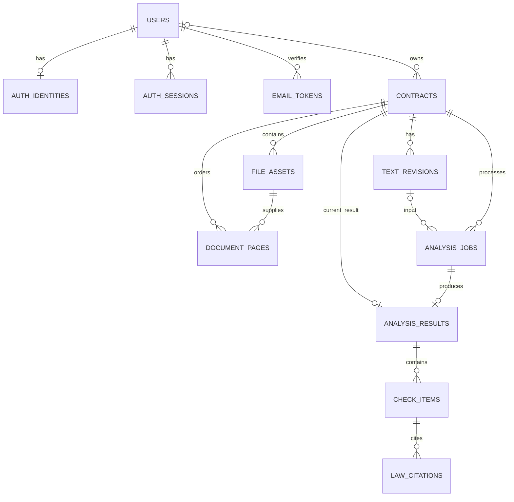

# CheckIt DB 구조 초안

작성일: 2026-10-21. 확정된 요구사항을 바탕으로 작성한 검토용 설계입니다. PostgreSQL·Chroma 사용은 확정됐으며, 아래 테이블·필드·관계는 구현 전에 검토할 초안입니다. 실제 DB·마이그레이션은 아직 생성하지 않았습니다.

> 범위 변경: 비밀번호 재설정·회원 탈퇴는 첫 버전에서 제외됐습니다. 2026-10-26 계정 연결을 제외하고 제공자별 독립 계정으로 변경했으며, 2026-11-08 모든 계약서 기능을 회원 전용으로 변경했습니다.
> 최신 변경: 화면 종료 후 분석 지속·진행 상태 재접근은 첫 버전에서 제외했습니다. 추출·분석 HTTP 요청이 완료 결과를 직접 반환합니다. 아래 내부 작업 ID·취소·상태 정보는 서버 실행 제어를 위한 후보이며 별도 상태 조회 API를 뜻하지 않습니다. 작업 실행 방식·연결 종료 처리는 단순화안에 맞춰 후속 조정합니다.
## 저장소 역할

| 저장소 | 역할 |
| --- | --- |
| PostgreSQL | 계정·인증, 계약서·파일 정보, 텍스트, 작업 상태, 현재 결과·인용 근거 |
| Chroma | 법령 청크·임베딩·검색 메타데이터 |
| 로컬 서버 전용 폴더 | PDF·사진 원본과 미리보기 등 파생 파일 |

사용자 계약서는 법령 검색용 Chroma 컬렉션에 자동으로 넣지 않습니다. 파일은 DB에 바이너리로 저장하지 않고 내부 저장 키로 연결합니다.

사용자 파일은 업로드 시 서버가 별도 사본을 저장합니다. 사용자의 원래 기기 파일 경로만 참조하는 것이 아닙니다. PostgreSQL에는 파일의 위치·소유권·텍스트·결과를 저장하며, Chroma에는 법령 검색 데이터를 둡니다.

각 테이블·컬럼의 의미, 타입·도메인·NULL 조건과 예시는 [DB 테이블·속성·도메인 설명서](database-dictionary.md)를 참고하세요. 세부 필드는 검토용 제안입니다.

## 관계도

모든 계약서는 활성 회원 한 명이 소유하며 소유자는 변경할 수 없습니다.

## 핵심 테이블

공통으로 내부 ID는 UUID, 시간은 시간대가 있는 값으로 저장하는 것을 제안합니다. 필드 이름과 구체적인 타입은 후속 스키마에서 정합니다.

| 테이블 | 주요 필드 후보 | 목적 |
| --- | --- | --- |
| `users` | `id`, `status`, `email_verified_at`, 생성 시각 | 공통 회원 계정. 인증 전에는 pending 상태, 인증 완료 시 active |
| `auth_identities` | `user_id`, `provider`, `provider_subject`, `email`, `password_hash` | 제공자별 계정의 로그인 수단 한 개. user_id 고유 제약 후보, 이메일이 같아도 제공자가 다르면 별도 계정 |
| `auth_sessions` | `user_id`, 세션 비밀값의 해시, 만료·폐기 시각 | 회원 로그인 유지·로그아웃·탈퇴 시 접근 차단. 구체적인 세션 방식은 미확정 |
| `email_tokens` | `user_id`, `purpose`, 토큰 해시, 만료·사용 시각 | 이메일 인증·비밀번호 재설정용 일회성 링크. 유효 시간은 미정 |
| `contracts` | `id`, `user_id`, `contract_type`, `input_kind`, `first_uploaded_at`, `deletion_state` | 회원 소유 계약서 한 건과 삭제 상태 |
| `file_assets` | `contract_id`, `role`, `storage_key`, 원본 파일명, 실제 형식·바이트 수, 파일 세대 ID | 원본·파생 파일의 실제 저장 위치 관리. 파일 교체와 이전 파일 정리 구분 |
| `document_pages` | `contract_id`, `file_asset_id`, `source_page_number`, `page_order`, 크기 | PDF 한 파일의 여러 페이지, 또는 사진별 페이지 순서 |
| `text_revisions` | `contract_id`, `revision`, `kind`, `content`, `blocks`, `confirmed_at` | OCR 원문과 사용자 수정본·좌표 연결. blocks는 JSONB 후보 |
| `analysis_jobs` | `contract_id`, `kind`, `input_revision_id`, 파일 세대 ID, `status`, `stage`, 오류 코드·복구 행동, 취소·시작·종료 시각 | OCR·분석 실행과 실패·취소·재시도 추적 |
| `analysis_results` | `contract_id`, `job_id`, `input_revision_id`, `summary`, 모델·프롬프트·corpus 버전, 완료 시각 | 계약서별 현재 제공 결과 한 건 |
| `check_items` | `result_id`, 점검 코드·라벨·상태, 인용 문장, 설명, 확인할 정보, 원본 위치 | 결과의 주제별 점검 항목. 누락 의심 항목은 연결 문장이 없을 수 있음 |
| `law_citations` | `check_item_id`, 법령·조문·청크 ID, 원문, 시행일, 출처 URL, corpus 버전 | 결과 생성 당시 실제 사용한 근거 스냅샷 |

텍스트가 수정되면 원본 OCR을 덮어쓰지 않습니다. 기존 결과가 참조하는 텍스트는 재분석 완료 전까지 유지합니다. 사용자에게 과거 분석 비교 기능을 제공한다는 뜻은 아니며 내부 텍스트 버전 정리 범위는 후속 설계 대상입니다.

## 요구사항별 데이터 처리

### 작업 상태와 한 건씩 실행

- 작업 종류는 `EXTRACTION`, `ANALYSIS`로 구분하는 안입니다.
- 작업 상태 후보: `QUEUED`, `RUNNING`, `CANCEL_REQUESTED`, `CANCELLED`, `SUCCEEDED`, `FAILED`.
- 텍스트 확인 대기는 작업을 계속 실행하는 상태가 아니라, 계약서가 확정된 입력을 기다리는 상태로 표현합니다.
- 추가 분석 접수 시 회원 세션 기준으로 실행 중 작업을 검사합니다. 여러 탭의 동시 요청을 막으려면 소유자 행 잠금 등 서버의 원자적 제어가 필요합니다.
- 취소 요청 중인 작업도 아직 실행 중으로 취급합니다. 서비스 전체의 작업자 수 제한과 사용자당 한 건 제한은 별개입니다.
- 추출 중에도 사용자당 한 건 제한을 적용할지는 아직 미정입니다. 본 초안이 이를 확정하지 않습니다.
- 작업자 강제 종료·중복 실행에 대비한 실행 소유권·heartbeat·재처리 방식은 작업 실행 구조 설계에서 정합니다.

### 최신 결과로 교체

- 새 분석은 입력 텍스트 버전·파일 세대와 연결합니다. 실행 중 다른 입력으로 바뀌어도 결과를 엉뚱한 원본에 연결하지 않습니다.
- 완료 직전 취소·삭제·만료 여부와 유효한 실행 ID를 확인합니다.
- 성공한 결과·점검 항목·인용 근거를 하나의 PostgreSQL 트랜잭션으로 교체하고 작업 완료 상태를 함께 갱신합니다.
- 실패·취소 시 기존 현재 결과는 유지합니다. 재분석 중 기존 결과는 이전 입력을 기준으로 한 결과임을 표시합니다.
- 교체된 과거 결과·점검 항목·인용은 사용자 이력으로 남기지 않습니다. 원본과 입력 추적에 필요한 최소 내부 메타데이터의 정리 방식은 미정입니다.

### 기록 삭제·탈퇴

- 삭제 요청 즉시 접근을 막고 작업 취소·결과 게시 차단을 적용합니다. 휴지통·복구 기능은 제공하지 않습니다.
- 실제 파일 삭제와 PostgreSQL 삭제는 하나의 DB 트랜잭션으로 묶을 수 없습니다. 파일 삭제가 실패해도 재처리할 수 있도록 내부 삭제 상태·정리 작업 기록을 유지한 뒤 최종 제거하는 방식을 제안합니다.
- 삭제 대기 정보는 사용자에게 복구 가능한 기록을 뜻하지 않습니다. 정리 작업의 파일 키도 사용자 데이터이므로 정리 완료 후 제거합니다.
- 삭제·탈퇴 후에도 작업자가 늦게 결과를 저장하지 못하도록 실행 상태를 검증합니다. 탈퇴 시 로그인 세션·인증 토큰·로그인 연결도 제거합니다.
- 특정 계약서 삭제로 공용 법령 Chroma 컬렉션을 삭제하지 않습니다.

## 제약·인덱스 후보

- `auth_identities(provider, provider_subject)` 고유: 동일 제공자의 고유 사용자가 중복 가입되지 않도록 합니다. auth_identities.user_id도 UNIQUE로 제한해 계정당 수단 하나를 표현합니다. 제공자를 넘는 이메일 전역 UNIQUE는 적용하지 않습니다. email 수단은 정규화된 식별자 정책을 정합니다.
- `contracts.user_id`는 활성 회원을 가리키며 필수이고 변경할 수 없습니다. 인증 대기 계정에는 저장 기록을 귀속하지 않습니다.
- `(user_id, created_at)` 인덱스로 회원 목록 조회를 지원합니다.
- `document_pages(contract_id, page_order)` 고유: 페이지 순서 충돌 방지. 순서 변경은 일괄 처리합니다.
- `text_revisions(contract_id, revision)` 고유, `analysis_results(contract_id)` 고유: 텍스트 버전과 현재 결과 식별.
- 종속 입력·페이지·결과가 같은 계약서에 속하는지는 복합 외래 키 또는 트랜잭션 검증으로 보장합니다. UUID만 유효하다고 허용하지 않습니다.
- 파일 수·페이지 수·전체 용량·PDF와 사진 혼합 제한은 파일 검증과 계약서 단위 원자적 업데이트에서 검사합니다.

## 다음 설계

1. 각 테이블의 필수·선택 필드와 구체적인 타입 확정.
2. 로그인 세션·이메일 토큰의 수명과 전달 방식 결정.
3. API 명세 및 AI 패키지 입출력 정의.
4. DB 접근·마이그레이션 도구와 작업 실행 구조 선택 후 실제 스키마 구현.
